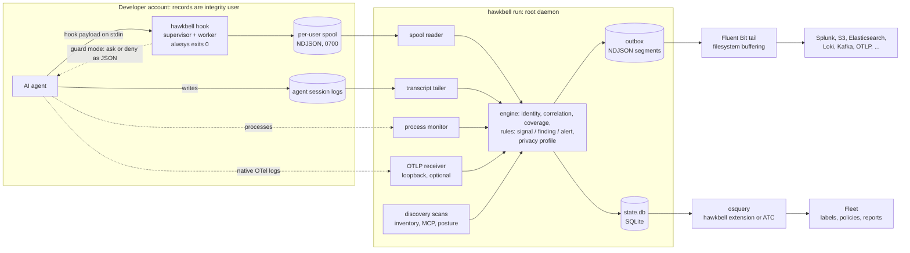

# hawkbell

hawkbell is a detection sensor for AI coding agents on developer machines and in containers. It sees what agents do through the agents' own hooks (Claude Code, Codex CLI, GitHub Copilot CLI, Gemini CLI and Cursor), their session logs, the processes they start and, where an agent exports them, its OpenTelemetry logs. It also inventories the 185 AI products in its catalog (72 of them agents and agent SDKs) with their MCP servers, hooks, skills, plugins and settings. 138 rules in 13 packs run on the endpoint and look for: credential access; remote scripts piped into an interpreter and other execution tricks; exfiltration, including a credential read earlier in the session leaving in an outbound request; persistence; defense evasion, including changes to hawkbell's own files and to the agents' managed policy; destructive commands; offensive tools; supply-chain worm indicators; agents changing their own hooks, permissions, MCP servers or model endpoint; MCP server and configuration posture; and agents running without hawkbell's hooks. Results leave the host through an outbox and a state database. The daemon writes NDJSON segments to a root-owned outbox, which Fluent Bit tails and ships to any output it supports. With `output.stdout` set, as in containers, the daemon also writes the same records to standard output for the cluster's log agent; `output.forward` and `output.otlp` are experimental shippers of the outbox segments ([internal/config/config.go](internal/config/config.go)). The daemon also keeps a state database that osquery reads as nine `hawkbell_*` tables, through hawkbell's osquery extension or auto table construction. The repository ships Fleet labels, policies and reports over those tables. One static Go binary is the daemon, the hook, the osquery extension and the command line.

## Data flow



- The hook is a supervisor that re-executes the binary as a worker under a deadline. It exits 0 on success, on a worker crash or timeout, and for guard decisions, which travel only in the JSON reply ([internal/hookcmd/doc.go](internal/hookcmd/doc.go)).
- The spool is writable by its user, so the daemon accepts only activity records from it, takes identity from the file owner and runs detection again ([internal/spool](internal/spool/spool.go)).
- The default privacy profile is `minimal`. Activity stays on the host, except a few preceding records of a session that travel with each finding as redacted context. Findings, inventory, posture, health and session summaries are shipped ([docs/PRIVACY.md](docs/PRIVACY.md)). In the state database, the tables derived from activity (`hawkbell_detections`, `hawkbell_sessions`) hold identifiers, the OS account, rule ids, titles, severities and counts, not commands or evidence values. The inventory, posture and process tables also hold install, configuration and executable paths and account names, and `hawkbell_posture` holds the observed value each failing check matched, cut to 256 bytes ([internal/state/tables.go](internal/state/tables.go)).
- The full component map, trust boundaries and design decisions are in [docs/DESIGN.md](docs/DESIGN.md).

## Coverage

### Agents by source

| Agent | Hooks, observe | Hooks, guard | Session logs | Process attribution | Native OTLP | Inventory and posture | Run with the real agent |
|---|---|---|---|---|---|---|---|
| Claude Code | yes (managed, user) | ask prompts, deny blocks; `--fail-closed` available | yes | yes | yes | yes | yes: 2.1.322 on Linux |
| Codex CLI | yes (managed, system, user) | deny blocks (no shipped rule denies; see Guard mode); ask is a warning and the action proceeds; which Codex release first accepts the JSON deny is unverified | yes, including `.jsonl.zst` archives | yes | yes | yes | no |
| GitHub Copilot CLI | yes (managed, user) | ask and deny; its hook timeouts always fail open | yes | yes | no: exports traces and metrics only | yes | no |
| Gemini CLI | yes (managed, user) | deny blocks (no shipped rule denies; see Guard mode); ask is a warning and the action proceeds | yes | yes | yes | yes | no |
| Cursor CLI and IDE (one `hooks.json`) | yes; payload format unverified | ask and deny; `--fail-closed` unverified | no: history is in SQLite | CLI yes; IDE no (weak marker only) | no: exports nothing | yes | no |
| 67 other catalogued agents and SDKs (`hawkbell catalog list --kind agent`, the rows with an empty HOOKS column) | no hook dialect | no | no | where the catalog fingerprints the process | no | inventory; MCP servers and settings where catalogued | no |

- "yes" means built and covered by unit tests with fixture payloads ([internal/hookio/testdata](internal/hookio/testdata), [internal/transcript](internal/transcript/doc.go), [internal/otelrecv](internal/otelrecv/doc.go)). Only Claude Code has run through the whole pipeline, with a local stand-in for the model API ([test/e2e/REAL-AGENT.md](test/e2e/REAL-AGENT.md)). The other dialects are written from vendor documentation and source.
- Guard semantics per agent are in [internal/hookcmd/doc.go](internal/hookcmd/doc.go) ("What ask and block mean per agent"). The guard column says what each agent does with a reply; no shipped rule asks for a deny (see Guard mode). Guard mode is advisory, not prevention: agents' own hook timeouts fail open by default, and always on Copilot CLI ([docs/LIMITATIONS.md](docs/LIMITATIONS.md#what-hawkbell-is-not)). A Codex user-scope `hooks.json` runs only after the user trusts it in `/hooks`.
- Process attribution uses the Linux process connector, then osquery's evented tables, then polling of `/proc` ([internal/procmon/doc.go](internal/procmon/doc.go)). Desktop apps and IDEs are not process roots.
- The OTLP receiver is optional and experimental: OTLP/HTTP JSON on loopback only. An optional, experimental adapter reads perplexityai/numbat records ([internal/adapter](internal/adapter/doc.go)).
- Inventory covers the whole catalog: `hawkbell catalog list` prints 185 products, including desktop apps, IDE extensions, model runtimes, CI agent actions and AI browsers ([internal/catalog/data](internal/catalog/data)).

### Platforms

| Platform | Status | Record |
|---|---|---|
| Linux x86-64 | Run end to end: daemon, hooks in observe and guard mode, Fluent Bit 5.2.0, Fleet 4.94.1 with osquery 5.19.0, Claude Code 2.1.322. deb and rpm installed, upgraded and removed in Debian bookworm and Rocky Linux 9 containers. Not run: the systemd unit (no systemd in those containers; the daemon was always started by hand or by a test). | [deploy/fleet/VERIFIED.md](deploy/fleet/VERIFIED.md), [deploy/fluent-bit/VERIFIED.md](deploy/fluent-bit/VERIFIED.md), [test/e2e/REAL-AGENT.md](test/e2e/REAL-AGENT.md), [packaging/README.md](packaging/README.md) |
| Linux arm64 | Compiles only | [packaging/README.md](packaging/README.md) |
| macOS amd64, arm64 | Compiles; `go vet ./...` for amd64 type-checks the tests. Unit tests have not run on macOS and nothing has run on a Mac. | [docs/LIMITATIONS.md](docs/LIMITATIONS.md#macos-and-windows) |
| Windows amd64, arm64 | Compiles; `go vet ./...` for amd64 type-checks the tests. Unit tests have not run on Windows and nothing has run on a Windows host. | [docs/LIMITATIONS.md](docs/LIMITATIONS.md#macos-and-windows) |
| Containers, Kubernetes | Node sensor and in-image hook mode run under Docker 29.9.2 (runc, overlayfs, cgroup v1), with the DaemonSet's pod spec reproduced as `docker run` flags. Not run under a kubelet, containerd's CRI, CRI-O or cgroup v2. | [deploy/kubernetes/VERIFIED.md](deploy/kubernetes/VERIFIED.md) |

The CI workflow (Linux, macOS and Windows jobs) is in `hawkbell/.github/workflows`, where GitHub does not run it, and it has never run ([.github/workflows/ci.yml](.github/workflows/ci.yml), header).

## Quick starts

### Build from source

Needs Go 1.26 or later ([go.mod](go.mod)).

```sh
make build                 # static binary in dist/hawkbell (make help lists every target)
make test                  # unit tests; no network, no docker
dist/hawkbell rules test   # every rule's inline tests
make cross                 # linux, darwin and windows, amd64 and arm64, into dist/<os>_<arch>/
```

### Linux package

```sh
make package                                # needs nfpm on PATH; deb and rpm for amd64 and arm64 in dist/
sudo dpkg -i dist/hawkbell_*_amd64.deb      # or: sudo rpm -i dist/hawkbell-*.x86_64.rpm
sudo hawkbell hooks install                 # managed scope: every agent hawkbell has a hook dialect for
sudo hawkbell doctor                        # one-screen health check
```

The package installs `/usr/bin/hawkbell`, creates the `hawkbell` group, `/etc/hawkbell/hawkbell.yaml` and `/var/lib/hawkbell`, and installs the systemd unit. Its post-install step rewrites only hook entries that are already there, which keeps them current on upgrade but registers nothing on a first install: run `hooks install` once. What the maintainer scripts do, and what was tested, is in [packaging/README.md](packaging/README.md). Without systemd, run the daemon in the foreground with `sudo hawkbell run`.

### Hooks for one user (observe mode)

```sh
hawkbell hooks install --scope user --dry-run   # the plan and a diff of each file, nothing written
hawkbell hooks install --scope user             # Claude Code, Codex, Copilot CLI, Gemini CLI, Cursor
hawkbell hooks status --scope user
```

The hook runs the binary that installed it (or `--binary`), so put the binary where it will stay. Without the daemon, hook records stay in the user's spool (`~/.local/state/hawkbell/spool` on Linux; `~/Library/Application Support/hawkbell/spool` on macOS and `AppData\Local\hawkbell\spool` in the user's profile on Windows, from [internal/platform/dirs.go](internal/platform/dirs.go) and not run on either) until a hook deletes them, about 72 hours after their last write (`retention.spool`; [PRIVACY.md](docs/PRIVACY.md#retention) says when it is later, for example while the hook is switched off); `hawkbell detect ~/.local/state/hawkbell/spool` runs the rules over them.

### Guard mode

```sh
sudo hawkbell hooks install --scope managed --guard                # sets guard.mode: advisory in /etc/hawkbell/hawkbell.yaml
sudo hawkbell hooks install --scope managed --guard --fail-closed  # block when the hook itself fails: Claude Code and Cursor only
```

Guard mode is a setting in the machine configuration that every hook reads, not part of the hook registration. `hooks install --scope user --guard` registers the hooks, prints the change for an administrator and exits 5. In guard mode, rules whose response is `ask` or `block` answer the agent; the default deadline is 150 ms.

No shipped rule has response `block`: the 7 guard rules all answer `ask` (`hawkbell rules list --json`), and `guard.max_response` defaults to `ask`, which turns a `block` into an `ask` ([internal/config/config.go](internal/config/config.go), [internal/hookcmd/worker.go](internal/hookcmd/worker.go)). With the shipped rules, guard mode therefore never answers deny. Claude Code, Copilot CLI and Cursor get an ask. On Codex CLI and Gemini CLI that ask is a warning and the action proceeds. A deny needs a rule of your own with response `block` and `guard.max_response: block`.

### Fleet

```sh
hawkbell export fleet --out fleet-content   # the deploy/fleet tree with this host's paths
```

Choose a tier first: Fleet's own `ai_tools` table with no hawkbell binary; hawkbell's state database (written by a scheduled `hawkbell scan --state` or by the daemon) read through auto table construction; or the daemon with hawkbell registered as an osquery extension. Auto table construction and the extension cannot be mixed on one host. Read [deploy/fleet/README.md](deploy/fleet/README.md) before you apply anything: Fleet replaces agent options as a whole.

### Fluent Bit

```sh
hawkbell export fluent-bit --out flb   # inputs, parsers and output fragments for this host's outbox
fluent-bit -c flb/hawkbell.yaml --dry-run   # standalone example: Splunk and S3, read from environment variables
```

Then set `output.fluent_bit.tail_db` in hawkbell's configuration, so the daemon prunes only segments Fluent Bit has read. Fragments for Splunk, S3, Elasticsearch, OpenSearch, Loki, Kafka, OTLP, HTTP, Chronicle, Sentinel and file outputs are in [deploy/fluent-bit/outputs](deploy/fluent-bit/outputs). Settings and their reasons: [docs/FLUENT-BIT.md](docs/FLUENT-BIT.md).

### Kubernetes

```sh
make image   # node sensor image; push it and set it in deploy/kubernetes/kustomization.yaml
# on every Linux node:
install -D -m 0644 deploy/kubernetes/seccomp/node-sensor.json /var/lib/kubelet/seccomp/hawkbell/node-sensor.json
kubectl apply -k deploy/kubernetes
```

The node sensor sees processes, not hooks or session logs. It writes NDJSON to stdout for the cluster's log agent. For hooks and session logs from agents in containers, use in-image hook mode. Both modes, what they need and what is not supported: [deploy/kubernetes/README.md](deploy/kubernetes/README.md).

### Benchmarks

```sh
make bench   # scenario gate test, then the scenario report into dist/bench
go run ./internal/bench/cmd/benchrun -scenarios bench/scenarios -out /tmp/hb-bench
go run ./internal/bench/cmd/benchrun -replay ~/.claude/projects -home ~ \
    -labels bench/replay-labels.yaml -out /tmp/hb-replay   # your own Claude Code sessions as a benign corpus
```

The benchmark runner is not linked into the default build, to keep hook start-up fast. `go run -tags hawkbell_bench ./cmd/hawkbell bench --help` gives the same runner as a subcommand. The commands that made the committed reports are in [internal/bench/cmd/benchrun/main.go](internal/bench/cmd/benchrun/main.go).

## Measured results

Measured on Linux x86-64 VMs on 2026-11-12. The conditions and limits are in each linked file.

- **Scenario benchmark** (synthetic corpus written by this project, so recall is an upper bound): 95/100 attacks detected as written; 94/100 detected as written and under every applicable mutation and variant (315 mutation and variant runs). Of 87 benign look-alikes, 0 raised an alert, 5 a finding and 14 a signal ([bench/results/scenarios.md](bench/results/scenarios.md)). Path-spelling variants: 16/16 detected (same file, "After path canonicalisation").
- **Benign replay, release snapshot** (session logs of the Claude Code agents that built this project, replayed through the rules; 136 agent threads, 13,864 tool calls): 17 alerts, of which 4 red_team, 11 false_positive and 2 rule_bug. That is 13 false alerts, 0.94 per 1,000 tool calls, Wilson 95% [0.55, 1.60]. 72 finding-class hits ([bench/results/release-benign-replay.md](bench/results/release-benign-replay.md)).
- **Benign replay, earlier snapshot** (70 agent threads, 5,337 tool calls): 3 alerts, 1 red_team and 2 rule_bug, so 2 false alerts, 0.37 per 1,000, Wilson 95% [0.10, 1.37] ([bench/results/benign-replay.md](bench/results/benign-replay.md)). Both replays are one workload on one machine, so the results do not transfer to a fleet without measuring there.
- **Hook latency**, release build, p50 on a 4-vCPU VM: observe 10.42 ms direct, 10.97 ms through `sh -c` and 18.74 ms through `bash -lc`, against 1.33, 2.19 and 9.61 ms for an empty hook. Guard mode is 16.64 ms and in-hook detection 19.73 ms, direct ([internal/hookcmd/LATENCY.md](internal/hookcmd/LATENCY.md#current-figures-release-build-2026-11-12)). Spool pruning in the hook, added after those figures, moved observe mode by -0.06 to +0.28 ms at p50 when no scan was due and added 0.26 to 0.42 ms when a scan deleted three files (same file, "Spool pruning in the hook"). The design target of "a few ms" over an empty hook is not met.
- **Hook cost inside Claude Code 2.1.322** (earlier build, loaded host): 12 to 15 ms per event over a hook that only drains stdin, 18 to 23 ms in guard mode ([test/e2e/REAL-AGENT.md](test/e2e/REAL-AGENT.md#7-hook-overhead-inside-the-agent)).
- **Fleet**: `deploy/fleet/verify.sh` against Fleet 4.94.1 (Free) and plain osquery 5.19.0: 240 checks, 240 passed, both tiers ([deploy/fleet/VERIFIED.md](deploy/fleet/VERIFIED.md#rerun-after-the-rename-2026-11-12)).
- **Fluent Bit 5.2.0**, shipped configuration: 5,000 of 5,000 records delivered after Fluent Bit was killed with SIGKILL while the destination was down. The memory-buffering control delivered 0 of 5,000 ([deploy/fluent-bit/VERIFIED.md](deploy/fluent-bit/VERIFIED.md#rerun-after-the-rename-2026-11-12)).
- **Real agent**: Claude Code 2.1.322 on Linux, with a local stand-in for the model API. A `curl ... | sh` tool call reached Fluent Bit as an HB-EXEC-001 finding, and in guard mode the model was shown the refusal ([test/e2e/REAL-AGENT.md](test/e2e/REAL-AGENT.md#rerun-after-the-rename-2026-11-12)).
- **Rules**: `hawkbell rules test` runs 681 tests over 138 rules, 0 failed (packs hash `d3c2ecd19907`).

## Documentation

- [docs/DESIGN.md](docs/DESIGN.md): components, trust boundaries, data per privacy profile, decisions
- [docs/RULES.md](docs/RULES.md): the rule language, signed bundles and the catalogue of shipped packs
- [docs/EVENTS.md](docs/EVENTS.md): the record format and its JSON schema
- [docs/PRIVACY.md](docs/PRIVACY.md): what is collected, what leaves the host in each profile, retention
- [docs/LIMITATIONS.md](docs/LIMITATIONS.md): what hawkbell does not see, does not prevent and has not been tested on
- [docs/COMPARISON.md](docs/COMPARISON.md): hawkbell next to related open-source projects and Fleet's own tables
- [docs/ASSUMPTIONS.md](docs/ASSUMPTIONS.md): the design assumptions, the red-team review and its evidence
- [design/](design/), [redteam/](redteam/) and [research/](research/): historical design records of 2026-11-11 (the first design and decision ledger, the build specifications, the nine red-team notes and the research reports); the design and red-team records use the working name spoor, and the research reports were written before the project had a name (`research/fleet.md` uses the placeholder `aiguard`, `research/fluentbit.md` and `research/standards.md` use `agentwatch`); they describe prototypes and plans, not the release
- [SECURITY.md](SECURITY.md): reporting a vulnerability
- [CONTRIBUTING.md](CONTRIBUTING.md): building, testing and changing rules

## License and status

hawkbell is licensed under the Apache License 2.0 ([LICENSE](LICENSE)). [NOTICE](NOTICE) carries the project's copyright line and the notices of linked Apache-2.0 modules. [THIRD_PARTY_LICENSES](THIRD_PARTY_LICENSES) reproduces the license texts of every linked module, and `hawkbell licenses` lists each linked module with its version and license name.

Status: early, and not released. There is no version tag, and `make build` stamps `0.0.0-dev`. No binaries, packages or container images are published. Binaries are unsigned. The name was changed from the working name "spoor" on 2026-11-12. Run records made before the change use the old name and say so.
