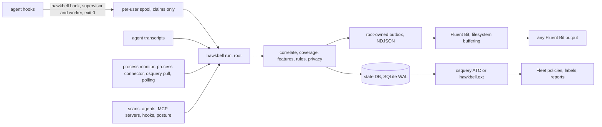

# Make the agent audible: building open AI-agent detection for Fleet and Fluent Bit, and red-teaming its design first

Coding agents now run on many developer laptops with the developer's own privileges: they read files, run shell commands, call MCP servers and push code. Teams that run Fleet and Fluent Bit want to know where agents are and how they are configured. They also want to see in their SIEM, soon after it happens, when an agent pipes a download into a shell, reads cloud credentials or plants an auto-run hook in a repository.

hawkbell is an open-source (Apache-2.0) Go sensor for that job. We wrote its first design down as 37 assumptions, attacked it with nine red-team lenses and had a second reviewer try to refute every finding. The first packages were written while the review ran; the rest was built to the design that came out of it. Then we ran it against a real agent, a live Fleet server, Fluent Bit and Docker, all on Linux x86-64.

The research, design, code, red team and measurements were done by Claude Code agent sessions in one build, over two days (2026-11-11 and 12). The reviewers below were such sessions, each given a persona, not people. Their notes, the research reports and the design records are published in the repository as written, with dated headers and redactions ([research/](../research/), [redteam/](../redteam/), [design/](../design/)).

## What already exists

We started from Uber's open-source ADR (Agentic AI Detection and Response) and read the code or documentation of the open-source alternatives; for numbat, Agent Beacon, Agentmetry and AgentSight the comparison rests on their documentation. For commercial products we could reach only search summaries of vendor pages, so we treat those as claims ([COMPARISON.md](COMPARISON.md)).

**uber/ADR** is the most complete public account of agent detection at scale; its paper covers over 7,200 hosts. Its Discovery CLI writes one JSON snapshot from a 37-product catalogue; its Sensor re-sends whole sessions over OTLP, with no hooks, redaction or tamper signal. Detection is GPT-4o triage, then Claude reasoning: precision 1.000 and recall 0.667 (28 of 42) on ADR's benchmark, at $0.024 and 18.5 seconds per task. Of the production alerts sent to human review, 49% were false positives, and the paper concedes that "by the time detections were surfaced, credentials had often already been exposed externally". Its best production number comes from no model: a regex-and-entropy secret scanner in a pre-prompt hook, at 97.2% precision (no recall reported). Prevention and the Explorer red-teaming engine are not public. ADR-Bench labels follow the attached MCP server: flagging any server never seen in a benign task catches 39 of the 42 recorded attacks with no false positives, so a score on it does not show whether a detector reads behaviour.

**Open source.** perplexityai/numbat (Apache-2.0, Go, v0.3.0) is the closest relative: 28 agents, managed hooks, CEL and sequence rules over a real shell parser, opt-in enforcement. Its documentation says its status check "does not prove that the agent loaded or trusted the hook", and its documentation mentions no heartbeat, osquery or Fluent Bit content. Agent Beacon (MIT, Go, 29 runtimes) keeps Fleet rollout and blocking in its Enterprise tier. Agentmetry (Apache-2.0, Python) has 14 sequence rules, a 57-case benchmark and a check for silent hooks. snyk/agent-scan (v0.6.11) runs no detection locally; its Agent Guard forwards every hook payload to Snyk and fails open. Fleet has shipped an `ai_tools` table since fleetd 1.59.0 (August 2026), so inventory is no longer a differentiator on a host running fleetd.

**Commercial products** (CrowdStrike's Falcon AIDR, now sold under Falcon Guardian; Pillar; Palo Alto Networks' Koi; Noma; Zenity), by those summaries, combine configuration discovery, the agents' native hooks, often an MCP proxy and, for EDR vendors, their kernel sensor. None publishes its schema, rules or a benchmark in the material we found.

What no open-source project ships, as far as we could verify on 2026-11-12: sensor health, per-agent hook coverage and findings as osquery tables with Fleet policies that fail closed; a Fluent Bit configuration tested by killing Fluent Bit with its output down; and a detection that checks the agent's self-reported surfaces against a root-observed one. That became the brief. The nearest to the third is AgentSight (MIT), which records processes and TLS traffic with eBPF but has no rules and no fleet management. hawkbell's own check is unit-tested and has not yet been shown end to end.

## What attacks look like in 2026

We catalogued 48 incidents and disclosures from 2025 and 2026 ([research/threats.md](../research/threats.md)); three classes stand out. The dominant one in the wild is supply-chain worms, not prompt injection. Miasma (June 2026), ChainDrop (August) and the Tensorlake compromise (October) planted agent auto-run configuration such as a `SessionStart` hook in `.claude/settings.json` (details from secondary compilations). A plant never passes through a tool-call hook; catching it needs configuration integrity and process lineage. The second class is "the repository is code": more than 40 CVEs where opening a folder, or an agent's file write, reaches execution, such as CVE-2025-59536 (Claude Code) and CVE-2026-19592 (Codex). The third is agent-mediated exfiltration and destruction, which tool-call telemetry does see.

## The first design

One binary installs each agent's native hooks. The hook sends events over a local socket to a root daemon or, without one, evaluates rules and appends to a per-user spool that Fluent Bit tails. Transcripts and process polling are two more surfaces, and disagreement between the three means tampering. Detections and inventory go to NDJSON for Fluent Bit and to SQLite for osquery's automatic table construction (ATC). Rules are deterministic, and by default only metadata ships ([design/v0.md](../design/v0.md)).

## Nine red-team lenses

Nine reviewers, each with a persona (evasion, detection quality, Fleet operator, pipeline operator, platform parity, containers, privacy and sensor security, skeptical buyer, alternative architectures), attacked the assumptions with Fluent Bit 5.2.0, osquery 5.19.0, Fleet 4.94.1, Go prototypes and real Claude Code transcripts. Agent behaviour beyond the transcripts came from documentation and source. The second reviewer re-ran experiments where it could, ran the Claude Code binary for one test, and re-read primary sources where it could not ([ASSUMPTIONS.md](ASSUMPTIONS.md), [redteam/](../redteam/)).

**The transport lost data.** With Fluent Bit's default memory buffering, 5,000 records read while the output was down, then a restart, delivered 0: tail had already committed its offsets. Pruning files while a memory-buffered Fluent Bit lagged lost 91% of 40,000 records. Inode reuse skipped 1,000 of 3,000 records with default settings; Fluent Bit 5.2.0 does this only when the 32 bytes before the stored offset are the same in the new file, as they were in that test. One 200 KB line stalled a segment under default settings. In the second reviewer's runs (buffering not recorded), one tail input for all streams let an unreachable archive keep all 10 detections from a healthy SIEM, and with filesystem buffering and unlimited retries one HTTP 401 dropped a chunk.

**The sensor was an attack surface.** A user appended a forged detection marked "cleared" and "approved by security", and activity attributed to another user, to their own spool, and Fluent Bit shipped both verbatim. A root Fluent Bit followed a planted symlink to a root-only file.

**Disagreement proved nothing.** The watched user controls what hooks and transcripts say and can evade the poller, which saw 7 of 120 short-lived processes at a one-second interval; osquery's audit-based `process_events` saw 5 of 5.

**Hooks are less universal than they look.** Claude Code's documentation says that by default a file-dropped managed hook is ignored when an MDM profile, an HKLM policy or server-managed settings set any policy key (from the documentation, not tested live). By default most agents launch a hook through a shell; Claude Code and Copilot CLI also offer an exec form, which hawkbell uses for Claude Code. In a prototype run, `sh -c` cost 2.5 ms at p50 against 1.7 ms direct, and a login shell (Codex's default on Unix) 8.5 ms. Go exits with status 2 on a fatal error, which the targeted agents read as "block this tool call" (Cursor only by search snippets; its documentation could not be read), and an in-process `recover()` still let four of five crash classes through.

**osquery and Fleet have sharp edges.** A missing database reads as zero rows, so "no bad thing" policies pass where the sensor was removed. Rollback-journal SQLite gave torn reads under ATC; WAL gave 0 in 75. A query over 300,000 rows tripped osquery's 200 MB watchdog while Fleet reported success.

**Privacy defaults were not private.** "Metadata only" would have shipped user name, working directory, paths, command lines and search queries for every tool call. An unkeyed hash was reversed for 4 of 6 sample prompts (3 to 73 characters long) with a 1,600-entry dictionary. Pattern-and-entropy redaction let 8 of 17 invented secrets through.

**The textbook "lethal trifecta"** (untrusted input, a secret read and egress in one session), replayed over 37 transcripts of one ordinary build session, found untrusted input in 68% and egress in 65%. Keyed by session, as designed, it fired 13 times over the 43 transcripts (0.89 hours) of the second reviewer's rerun; that rerun's output stayed on the build machine.

The verifier overturned one finding outright: on Claude Code 2.1.322, `--bare` still runs managed tool hooks, so it is an attribute to record, not a hook-free signal.

## The design that survived



- **The spool is a claim.** The hook appends to a private per-user spool; there is no socket. The root daemon accepts only activity from a spool, takes identity from the file's owner, marks it `integrity: user` and runs detection itself. User files are opened without following symlinks, non-blocking, and checked on the descriptor. Fluent Bit tails only a root-owned outbox. When the system spool cannot be used, as on a host without the daemon, the hook writes to a fallback spool in the user's home and deletes its own files there after the spool retention (72 hours by default).
- **Coverage is measured.** Each agent and account is `covered`, `partial`, `blind` or `absent`, from the records that arrive. "Hook bypass suspected" needs the process monitor, a root-observed surface, to see the agent running while its tool calls lack hook records.
- **The hook never blocks by crashing.** `hawkbell hook` is a supervisor that re-executes its own binary as a worker under a deadline. On a crash, hang or bad output it answers with an allow-shaped reply (observe mode) or "ask" (guard mode) and exits 0. Exit 2 is never used: a Codex block is the JSON decision Codex accepts on exit 0, checked against Codex's source.
- **Guard mode is opt-in and advisory.** By Claude Code's documentation, "ask" becomes a prompt there. Copilot CLI and Cursor's shell and MCP hooks accept "ask" too, but neither agent was run and Cursor's reply format is unverified; interactive prompting was not exercised. By their source and documentation (neither was run), Codex and Gemini CLI show a warning and the action proceeds, also when "ask" answers a timeout. Agents proceed by default when their own hook times out. Seven rules answer "ask"; none ships with "block".
- **Parsed shell, canonical paths, opacity as a feature.** An analyser for POSIX shells, PowerShell and cmd.exe extracts facts, and rules match facts only. `eval`, interpreter one-liners and decoded execution are marked opaque. Paths are put in one canonical form lexically (`.` and `..`, doubled separators, `/proc/<id>/root`, a `cd` earlier on the same command line, one-character bracket globs, Windows prefixes), so a path respelled in these ways meets the same rule; nothing is resolved on disk.
- **Secret flow, not co-occurrence.** The alert needs a value read from a credential file to reappear, raw or encoded, in a later outbound command, URL, DNS name or MCP argument. The session keeps keyed fingerprints, not values.
- **Minimal by default, still personal data.** The `minimal` profile ships findings, inventory, posture, health and session summaries; activity leaves only as redacted context of a finding. Digests are keyed with a key every endpoint holds, which protects against log-store readers, not root.
- **Fail-closed Fleet content, tested Fluent Bit settings.** Every "no X" policy also needs a heartbeat from the last 24 hours, so a stopped sensor or a deleted database fails within a day; a host whose hawkbell tables no longer load, as after the uninstall script on an extension host, answers no policy and shows in the "hawkbell tables unavailable" label instead. Fluent Bit runs with filesystem buffering, unlimited retries, separate inputs for findings and activity, and rejected chunks kept. hawkbell caps each record at 16 KiB, inside the 1 MiB line buffer of Fluent Bit's tail inputs.

## What we measured

Runs were on Linux x86-64 build VMs on 2026-11-12, timings on a shared 4-vCPU VM. Records made before the project got its public name use the earlier working name in their commands.

**A real agent** ([test/e2e/REAL-AGENT.md](../test/e2e/REAL-AGENT.md)). Claude Code 2.1.322 ran headless against a local stand-in for the model API that asked for `curl ... | sh` from a local server. Hooks came from `hawkbell hooks install --scope user`, and the daemon and the shipped Fluent Bit 5.2.0 fragments ran beside it. In observe mode the script ran, the outbox held one HB-EXEC-001 finding (severity high), and the session's 6 activity records stayed on the host, apart from redacted copies of 2 sent as the finding's context. Fluent Bit delivered the finding through the unchanged http output, over TLS with the bearer token. An observation output added for the test showed it tagged `hawkbell.detection`, with event time equal to its `ts` to the microsecond. In guard mode hawkbell answered "ask", headless Claude Code refused the call, and the script was never fetched; interactive prompting was not exercised. Three problems found here were fixed later and are unit-tested, not re-run by hand. The automated version of this test passed again after the rename, in 25 seconds.

**Hook cost** ([internal/hookcmd/LATENCY.md](../internal/hookcmd/LATENCY.md)). Timed with `tools/hooklatency` on a release build of the single binary (22.9 MB, 300 runs per case, a quiet VM), observe mode took 10.42 ms at p50 when the agent runs the hook directly, 10.97 ms through `sh -c` and 18.74 ms through `bash -lc`, against 1.33, 2.19 and 9.61 ms for an empty hook; p99 direct was 18.24 ms. Guard mode took 16.64 ms and evaluating rules inside the hook 19.73 ms (direct, p50); none of the 1,200 guard runs came near the 150 ms deadline. The supervisor's second process is about half the cost: the worker alone took 5.61 ms. Two start-up changes, an OpenTelemetry upgrade that removed regular expressions compiled at package init and compiling the remaining patterns on first use, cut observe mode from 14.53 ms at the rename commit. The design target of "a few milliseconds" over an empty hook is not met. Inside Claude Code, with an earlier build on a loaded host (10 runs per mode), hawkbell added 12 to 15 ms per hooked event over a drain-only control in observe mode and 18 to 23 ms in guard mode ([REAL-AGENT.md](../test/e2e/REAL-AGENT.md#7-hook-overhead-inside-the-agent)). Pruning the fallback spool, added after these figures, moved observe mode by -0.06 to +0.28 ms when no scan was due and added 0.26 to 0.42 ms when a scan deleted three files.

**Fluent Bit 5.2.0** ([deploy/fluent-bit/VERIFIED.md](../deploy/fluent-bit/VERIFIED.md)). The standalone configuration, and each of the 11 output fragments included next to `hawkbell-inputs.yaml`, pass `--dry-run`. The osquery, numbat and no-binary fragments ran in smoke tests; `kubernetes.yaml` was not tested. With the output down while 5,000 records were read, then a SIGKILL or graceful stop and a restart, the shipped configuration delivered 5,000 of 5,000 (default memory buffering: 0). With 20,000 activity records (3.5 MB) waiting for an unreachable archive, the shipped configuration delivered all 10 detections written afterwards to a healthy output within 6 seconds. With filesystem buffering a single tail input did the same behind 200,000 records (35 MB); only a single memory-buffered input (`mem_buf_limit 5M`) behind the same 35 MB delivered 0 of 10 (behind 3.5 MB it delivered all 10), so the split into two inputs matters when a memory-buffered input's backlog exceeds its `mem_buf_limit`. HTTP 400, 401 and 413 each dropped the chunk after one request, with no retry, and the chunk stayed on disk under `rejected/` with all its records; a 503 was retried and delivered. Losing the tail database re-sent everything still in the outbox, 5,000 records a second time, which is why delivery is at least once and destinations should deduplicate on the record `id`. Only the http output was tested end to end.

**Fleet** ([deploy/fleet/VERIFIED.md](../deploy/fleet/VERIFIED.md)). On Fleet 4.94.1 (Free) with one plain osquery 5.19.0 host, `verify.sh` ran 240 checks, 240 passed, through ATC and through `hawkbell.ext` (the same binary, started by osquery). Healthy: all 10 policies pass. A `curl | sh` hook payload with the daemon running: only the high-detections policy fails. Database removed: all 10 fail. All 9 `hawkbell_*` tables answered live queries. The install scripts were shortened afterwards so that they fit Fleet's 10,000-character script limit once real SHA-256 values are filled in; that version passed the container test of the scripts, not a new run against the Fleet server.

**Packages** ([packaging/README.md](../packaging/README.md)). deb (Debian bookworm) and rpm (Rocky Linux 9) went through install, upgrade and removal in containers without systemd, the deb also through purge; the shipped systemd unit has never been started. The upgrade left fail-closed guard hooks unchanged. Two independent builds of a test version, 0.1.1 (nothing is tagged or published), had the same SHA-256 on one machine and toolchain. A goreleaser snapshot built all six binaries (linux, darwin, windows on amd64 and arm64), unsigned.

**Node sensor** ([deploy/kubernetes/VERIFIED.md](../deploy/kubernetes/VERIFIED.md)). Under Docker 29.9.2 (cgroup v1, no kubelet, pod spec reproduced from `daemonset.yaml`), file capabilities survived into the image and the binary refused to start without both. As uid 65532 the sensor attributed a fake Claude Code (uid 1000) in another container, with that container's id. The shipped seccomp profile turned `ptrace` attach and four related calls against a root process into EPERM, where Docker's default allowed them. A confined scan refused five planted symlink escapes.

**Scenario benchmark** ([bench/results/scenarios.md](../bench/results/scenarios.md)). 100 attack scenarios from the 48 incident rows, 87 benign look-alikes and 315 mutation and variant runs, against 138 rules. The events are synthetic and written by the rules' author, so recall is an upper bound. Plain recall was 95/100 (Wilson 95% interval 88.8 to 97.8%). Robust recall, detection under every applicable mutation, was 54/100 until scripts written by a file tool were analysed when run, and is now 94/100 (87.5 to 97.2%). All 16 path-spelling variants were detected after path canonicalisation. Of the 87 look-alikes, none raised an alert (upper bound 4.2%), 5 raised at least one finding and 14 at least one signal. An oracle fitted on the same corpus, which fires on any tool, MCP server or program name seen only in attacks, reaches 45/100 with no false positives, so almost half the corpus can be separated by names alone.

**Benign replay** ([bench/results/release-benign-replay.md](../bench/results/release-benign-replay.md), [bench/results/benign-replay.md](../bench/results/benign-replay.md)). The rules replayed the session logs of the agents that built this project: one workload, as root, on one machine. The release snapshot has 136 agent threads of one root session and 13,864 tool calls. It raised 17 alerts; read one by one, 4 were red-team experiments (true positives without malice), 11 false positives and 2 rule bugs. That is 13 false alerts, 0.94 per 1,000 tool calls (Wilson 95% interval 0.55 to 1.60), and 72 finding-class hits, 5.19 per 1,000. An earlier snapshot, 70 threads and 5,337 tool calls, on which the rules were tuned (alert-class hits from 55 to 3), has 2 false alerts left, both rule bugs: 0.37 per 1,000 (0.10 to 1.37). The rules were tuned on the same workload they are measured on, so these rates bound only that workload; they do not transfer to a fleet without measuring there.

## What it does not do

hawkbell is a detection and assurance layer, not a control ([LIMITATIONS.md](LIMITATIONS.md)). Hook input and transcripts come from the agent, running as the developer, so someone who controls their machine can run an agent hook-free, transcript-free and renamed. It is built to catch careless or unmodified abuse, supply-chain worms and commodity infostealers. Guard mode is advisory; there is no kernel sensor and no LLM judge. It does not see inside commands assembled at runtime, scripts run in a later session, what the agent's code does, in-process exfiltration, MCP stdio or model traffic, or agents in vendor clouds, microVMs, WSL2 or on remote hosts. A user can forge activity about their own sessions, which can raise findings for that account, but cannot inject findings directly. Delivery is at least once only with the shipped Fluent Bit configuration, and a rejected chunk is kept, not retried. Windows and macOS builds cross-compile and their platform-independent logic is unit-tested on Linux; nothing has been tested on Windows or macOS hardware, and of the five agents hawkbell has hook dialects for (Claude Code, Codex, Gemini CLI, Copilot CLI, Cursor), only Claude Code has run for real. The node sensor needs `hostPID` and two capabilities, against the Baseline Pod Security Standard, and has not run under a kubelet. Binaries are unsigned.

## Try it

The code is in the `hawkbell/` directory of [github.com/thomastysong/thomastysong](https://github.com/thomastysong/thomastysong); until it is merged into `main` it is on the branch [`ccr-bb7c7571-wico2h`](https://github.com/thomastysong/thomastysong/tree/ccr-bb7c7571-wico2h/hawkbell). Build it ([CONTRIBUTING.md](../CONTRIBUTING.md)) and put the binary where it will stay, because hooks run that path (the packages use `/usr/bin/hawkbell`):

```
git clone -b ccr-bb7c7571-wico2h https://github.com/thomastysong/thomastysong   # without -b once merged into main
cd thomastysong/hawkbell
CGO_ENABLED=0 go build -o hawkbell ./cmd/hawkbell        # or: make build (writes dist/hawkbell)
sudo install -m 0755 hawkbell /usr/local/bin/hawkbell
hawkbell hooks install --scope user --agents claude-code --dry-run   # prints the diff
hawkbell hooks install --scope user --agents claude-code
sudo /usr/local/bin/hawkbell run --config /etc/hawkbell/hawkbell.yaml   # root daemon, in the foreground; the deb and rpm install a systemd unit
sudo /usr/local/bin/hawkbell doctor --json                              # from a second shell
```

For Fleet without the daemon (tier 2 in [deploy/fleet/README.md](../deploy/fleet/README.md)), schedule `hawkbell scan --state`, merge `deploy/fleet/lib/agent-options.atc.yml` into your agent options, apply `lib/stock` (or `lib/fleetd` on fleetd hosts), and check with `fleetctl gitops -f default.yml --dry-run`. For Fluent Bit ([FLUENT-BIT.md](FLUENT-BIT.md)), include `hawkbell-inputs.yaml` and an output fragment, set `storage.path` and `storage.keep.rejected: on`, set `HAWKBELL_OUTBOX`, and run `fluent-bit -c <file> --dry-run`. For Kubernetes ([deploy/kubernetes/README.md](../deploy/kubernetes/README.md)), build the image with `make image` (none is published), push it to your registry and set it under `images:` in `deploy/kubernetes/kustomization.yaml`, install the seccomp profile on each node, and run `kubectl apply -k deploy/kubernetes`.

## Credits

hawkbell reuses data and interoperability facts, not code, as [NOTICE](../NOTICE) details: uber/ADR (catalogue facts, skill folder hash, session-log record types), snyk/agent-scan (configuration paths, Cursor hook shapes), perplexityai/numbat (the record format hawkbell's adapter reads), karmine05/agentic-detector via Fleet's `ai_tools` (columns, risk flags), Fleet (session-log shapes, application identifiers), osquery (placeholder hardware UUIDs), aquasecurity/tracee (cgroup prefixes) and moby/profiles (the seccomp base). Agent Beacon, 1Password/agent-hooks, johnlindquist/cursor-hooks and endorlabs/mdm-scripts were read for wire formats and file locations. The binary links mvdan.cc/sh, modernc.org/sqlite, osquery-go and the modules in [THIRD_PARTY_LICENSES](../THIRD_PARTY_LICENSES).

## Sources

Relative links point into the hawkbell directory of the repository. The research reports and red-team notes are historical records of 2026-11-11; the primary sources they rest on are listed here.

**What already exists.** Research reports: [research/adr-paper.md](../research/adr-paper.md), [research/adr-discovery.md](../research/adr-discovery.md), [research/adr-sensor.md](../research/adr-sensor.md), [research/adr-detection.md](../research/adr-detection.md), [research/small-oss.md](../research/small-oss.md), [research/snyk-agent-scan.md](../research/snyk-agent-scan.md), [research/paid-vendors.md](../research/paid-vendors.md), [research/fleet.md](../research/fleet.md). uber/ADR, https://github.com/uber/adr at commit 6b33dff (2026-10-16): `docs/adr-paper.pdf` (MLSys 2026 Industry Track: p. 1 for scale, Table 2 for the benchmark result, §6.1 on p. 9 for alert labels, §6.2 on pp. 9 and 10 for the pre-prompt hook, p. 10 for the quote), `README.md` (what is not released), `Discovery/` (catalog version 2026.10.12), `Sensor/`, `Detection/README.md` and the ADR-Bench task and session files. numbat v0.3.0, https://github.com/perplexityai/numbat: `README.md`, `docs/deployment.md`, `docs/agent-coverage.md`. Agent Beacon, https://github.com/asymptote-labs/agent-beacon (`README.md`: runtime matrix; `docs/deployment/plans.mdx`: plans table). AgentSight, https://github.com/eunomia-bpf/agentsight (`README.md`). Agentmetry, https://github.com/blitzcrieg1/agentmetry (`master` branch) and its PyPI release 0.11.0. snyk/agent-scan v0.6.11, https://github.com/snyk/agent-scan at commit 59def8c: `src/agent_scan/hooks/snyk-agent-guard.sh`, `src/agent_scan/verify_api.py`. Fleet, https://github.com/fleetdm/fleet at commit 27178c8: `orbit/pkg/table/ai_tools/`, `orbit/CHANGELOG.md`. Commercial products: search-tool summaries of vendor and press pages only; the vendor sites (crowdstrike.com, pillar.security, zenity.io and others) could not be reached, so no primary source for those products was read (Endor Labs' public MDM scripts, credited above, were read for hook locations). Also [COMPARISON.md](COMPARISON.md) and [ASSUMPTIONS.md](ASSUMPTIONS.md) ("The thesis itself").

**What attacks look like in 2026.** [research/threats.md](../research/threats.md). CVE records in https://github.com/CVEProject/cvelistV5: CVE-2025-59536, CVE-2026-19592 (67 records were read for the catalogue). Secondary compilations for Miasma, ChainDrop and Tensorlake: https://github.com/jchable/miasma-toolkit (`README.md`, `iocs.psd1`), https://github.com/webpro255/awesome-ai-agent-attacks, https://github.com/DavidFarago/ai_security_incidents_2026. The 48 rows as benchmark scenarios: [bench/scenarios](../bench/scenarios).

**The first design and the red team.** [design/v0.md](../design/v0.md) (the first design; assumptions in sections 11 and 12), [design/DECISIONS.md](../design/DECISIONS.md) (the ledger of verdicts), the nine notes in [redteam/](../redteam/), and [ASSUMPTIONS.md](ASSUMPTIONS.md): assumptions A1 to A37, the nine lenses, the evidence for each break and the verifier's corrections (trifecta, `--bare`, crash classes). The transport findings are in [redteam/pipeline-operator.md](../redteam/pipeline-operator.md); the head-of-line and HTTP 401 ones come from the verification pass ([design/BUILD-C.md](../design/BUILD-C.md), Addendum, C6) and were measured again on the release ([deploy/fluent-bit/VERIFIED.md](../deploy/fluent-bit/VERIFIED.md)). Fluent Bit's check on a reused inode: `plugins/in_tail/tail_file.c` at v5.2.0 (`compute_offset_marker`, `flb_tail_file_offset_marker_matches`). The hook-shell costs are in [redteam/platform-parity.md](../redteam/platform-parity.md) (E4). Software: Fluent Bit 5.2.0 (https://github.com/fluent/fluent-bit, image `fluent/fluent-bit`), osquery 5.19.0 (https://github.com/osquery/osquery), Fleet 4.94.1 (https://github.com/fleetdm/fleet), Claude Code 2.1.322. Codex's hook shell: https://github.com/openai/codex, the command runner in `codex-rs/hooks/src/engine/` (read, then emulated; real Codex was not run). Claude Code's managed-source precedence and hook contract: https://code.claude.com/docs/en/managed-settings, https://code.claude.com/docs/en/server-managed-settings, https://code.claude.com/docs/en/hooks.

**The design that survived.** [DESIGN.md](DESIGN.md), [PRIVACY.md](PRIVACY.md) (profiles, spool retention), [RULES.md](RULES.md) (rule classes, the seven `response: ask` rules), [EVENTS.md](EVENTS.md) (coverage states), [FLUENT-BIT.md](FLUENT-BIT.md), [deploy/fleet/README.md](../deploy/fleet/README.md) (heartbeat guard), [internal/hookcmd/doc.go](../internal/hookcmd/doc.go) and [internal/hookio/doc.go](../internal/hookio/doc.go) (supervisor, replies per agent), [internal/rules/doc.go](../internal/rules/doc.go) (secret flow), [internal/pathcanon/pathcanon.go](../internal/pathcanon/pathcanon.go) and [LIMITATIONS.md](LIMITATIONS.md) (path canonicalisation). Codex's JSON block: https://github.com/openai/codex, `codex-rs/hooks/src/engine/output_parser.rs` and `codex-rs/hooks/src/events/pre_tool_use.rs` (main branch, read 2026-11-12).

**What we measured.** [test/e2e/REAL-AGENT.md](../test/e2e/REAL-AGENT.md) (the hand runs and the rerun after the rename); [internal/hookcmd/LATENCY.md](../internal/hookcmd/LATENCY.md) ("Current figures", "Two start-up changes", "Spool pruning in the hook"); [deploy/fluent-bit/VERIFIED.md](../deploy/fluent-bit/VERIFIED.md) (the kill test, and the sections on head-of-line blocking, a lost tail database and HTTP status codes); [deploy/fleet/VERIFIED.md](../deploy/fleet/VERIFIED.md) ("Rerun after the rename", "Script changes after the rename"); [packaging/README.md](../packaging/README.md); [deploy/kubernetes/VERIFIED.md](../deploy/kubernetes/VERIFIED.md); [bench/results/scenarios.md](../bench/results/scenarios.md) and [bench/results/scenarios-notes.md](../bench/results/scenarios-notes.md) (write-then-run, path canonicalisation, the trivial oracles); [bench/results/release-benign-replay.md](../bench/results/release-benign-replay.md) and [bench/results/release-benign-replay-notes.md](../bench/results/release-benign-replay-notes.md) (the 17 alerts read one by one); [bench/results/benign-replay.md](../bench/results/benign-replay.md) and [bench/results/benign-replay-notes.md](../bench/results/benign-replay-notes.md) (tuning, and the rule bugs found at the release commit).

**What it does not do.** [LIMITATIONS.md](LIMITATIONS.md), [SECURITY.md](../SECURITY.md).

**Try it.** [CONTRIBUTING.md](../CONTRIBUTING.md), [deploy/fleet/README.md](../deploy/fleet/README.md), [FLUENT-BIT.md](FLUENT-BIT.md), [deploy/kubernetes/README.md](../deploy/kubernetes/README.md), [packaging/README.md](../packaging/README.md) (install paths), [test/e2e/REAL-AGENT.md](../test/e2e/REAL-AGENT.md) (the hook commands as run).

**Credits.** [NOTICE](../NOTICE), [THIRD_PARTY_LICENSES](../THIRD_PARTY_LICENSES), `go.mod`.
