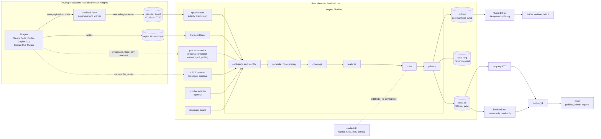

# hawkbell design, as built

This document describes hawkbell as it exists in this repository on 2026-11-12: the components and what each is responsible for, where the trust boundaries are, what happens to a record under each privacy profile, the main decisions and why they were taken, and what changed once the first version was built and run against real software. Each component's package documentation is the authority; this page summarises it and links to it. The red-team review that produced most of the decisions, with its evidence, is in [ASSUMPTIONS.md](ASSUMPTIONS.md); the limits that follow from it are in [LIMITATIONS.md](LIMITATIONS.md).

hawkbell is one static Go binary (`cmd/hawkbell`, CGO disabled). The same binary is the root daemon (`hawkbell run`), the hook every agent calls (`hawkbell hook`), the osquery extension (when osquery starts it as `hawkbell.ext`) and the operator's command line (`scan`, `detect`, `hooks`, `rules`, `doctor`, `privacy`, `export`, `bundle`, `catalog`, `ci`). Everything below was built and exercised on Linux x86-64. For macOS and Windows the code cross-compiles and `go vet` type-checks its tests, but the unit tests run on Linux only, so the platform-specific code (Windows ACLs and service control, macOS host identity, the Windows caller-chain snapshot) has been compiled and never executed; no run record contains a run on either system ([LIMITATIONS.md](LIMITATIONS.md#macos-and-windows)).

## Architecture

Two output planes leave the host. The **stream plane** is the outbox: NDJSON segments, one stream per record kind (`<stream>-<YYYYMMDD>-<HH>-<n>.ndjson`), which Fluent Bit tails and delivers ([FLUENT-BIT.md](FLUENT-BIT.md)). The **state plane** is the state database: what is true on the host now (inventory, posture failures, recent detections, session rollups, agent processes, coverage, sensor health), read by osquery as nine `hawkbell_*` tables and by Fleet through them ([deploy/fleet/README.md](../deploy/fleet/README.md)). The stream plane carries history and evidence; the state plane carries answers to "which hosts have X now", which is what Fleet policies are good at.

Deployment shapes, from the least to the most installed: Fleet tables only over fleetd's own `ai_tools` (no hawkbell binary); a periodic `hawkbell scan --state` with auto table construction; the daemon with hooks and Fluent Bit (the supported mode); a Kubernetes node sensor or in-image hooks; and `hawkbell ci exec` (experimental).

## Components

| Component | Package | Responsibility (from the package documentation) | Runs as |
|---|---|---|---|
| Event contract | [`internal/event`](../internal/event/event.go) | The normalized record every source emits and every sink serializes: one JSON object per line, closed vocabularies, local-only fields (`Content`, `Feat`) that are never serialized | n/a |
| Configuration | [`internal/config`](../internal/config/config.go) | The single definition of every operator setting; defaults are safe (observe only, `minimal` profile) | n/a |
| Hook entrypoint | [`internal/hookcmd`](../internal/hookcmd/doc.go) | `hawkbell hook`: never break the agent, be fast, then see and gate. A supervisor re-executes the binary as a worker under a hard deadline; it exits 0 on success, on every crash or timeout of the worker and for guard blocks (Codex's included, sent as JSON), so decisions travel only in the agent's JSON reply | the developer |
| Hook dialects | [`internal/hookio`](../internal/hookio/doc.go) | Pure translation between each agent's hook wire format and the event model, and rendering of a decision back into the reply that agent understands; input capped in size and depth | the developer |
| Hook installer | [`internal/hookinstall`](../internal/hookinstall/doc.go) | Plans, applies, removes and audits the hook registrations (managed and user scope); exec-form handlers where the agent supports them; reports `shadowed`, `modified` and other sensors' handlers; imports no `os/exec` | the operator |
| Spool | [`internal/spool`](../internal/spool/spool.go) | Hand-off from hook to daemon: one `write(2)` per record under a lock with gapless per-stream sequence numbers; the reader treats every line as a claim (activity only, identity from the file owner, no-follow and non-blocking opens, per-uid token bucket) | hook as the developer, reader as root |
| Daemon | [`internal/daemon`](../internal/daemon/doc.go) | `hawkbell run`: wires every collector to the pipeline, keeps outbox, local ring, state database and checkpoints within their limits, prunes the outbox only past what Fluent Bit's tail database shows as read, pulls and hot-loads signed bundles, sets file modes and ownership | root (or, in a pod, a non-root uid with `CAP_DAC_READ_SEARCH` and `CAP_SYS_PTRACE`) |
| Transcript tailer | [`internal/transcript`](../internal/transcript/doc.go) | Incremental reading of Claude Code, Codex, Copilot CLI and Gemini CLI session logs; the second surface next to hooks; truncation, replacement and deletion of a followed log are reported | root |
| Process monitor | [`internal/procmon`](../internal/procmon/doc.go), [`internal/osqexec`](../internal/osqexec/doc.go) | The OS-side view: agent processes, their flags and parents, and the processes they start; exec events from the Linux process connector, else from osquery's evented tables pulled over its socket, else polling; a periodic exec canary reports whether the exec feed really works | root |
| OTLP receiver | [`internal/otelrecv`](../internal/otelrecv/doc.go) | Optional, experimental: the agents' own OpenTelemetry logs (OTLP/HTTP JSON on loopback) as a third agent-reported surface | root |
| Adapters | [`internal/adapter`](../internal/adapter/doc.go) | Optional, experimental: perplexityai/numbat records converted into hawkbell events, so a site that runs numbat keeps its hooks | root |
| Discovery | [`internal/discovery`](../internal/discovery/doc.go), [`internal/catalog`](../internal/catalog/doc.go), [`internal/mcpconf`](../internal/mcpconf/mcpconf.go) | Inventory of agents and everything that configures them (MCP servers, skills, plugins, hooks, extensions, project control files) and posture facts; fingerprints are data; never executes what it finds | root, or the operator for a one-shot scan |
| Pipeline | [`internal/engine`](../internal/engine/doc.go) | Exclusions, identity, one activity record per action (hook primary, transcript or OTel twin held 10 s), coverage and the hook-bypass finding, features and rules, class floor, context for findings, session summaries, rate limits, privacy routing, state updates, heartbeat | inside the daemon (also in `scan`, `detect` and in-hook detection) |
| Features | [`internal/features`](../internal/features/doc.go), [`internal/shellx`](../internal/shellx/doc.go), [`internal/classify`](../internal/classify/doc.go), [`internal/toolmap`](../internal/toolmap/toolmap.go) | Turn one event into the flat facts rules match on: parsed shell commands (POSIX, PowerShell, cmd.exe, unwrapping wrappers and inline code), path, host and secret classes, written-script facts; credentials removed from anything about to leave | library |
| Rules | [`internal/rules`](../internal/rules/doc.go) | A strict YAML rule language over the feature view, compiled into a set; an engine with bounded per-session state (flags, thresholds, written paths, secret fingerprints, dedup, suppressions); rule classes signal, finding and alert | library |
| Privacy | [`internal/privacy`](../internal/privacy/doc.go) | Decides what leaves the endpoint: emit profiles, structural redaction, the evidence allowlist, context rendering, the line cap on the encoded record | library |
| Sinks and formats | [`internal/sink`](../internal/sink/sink.go), [`internal/format`](../internal/format/doc.go) | One durable queue: NDJSON segment files that are both the local log and the contract with Fluent Bit; optional shippers that tail the segments with their own checkpoints; native, OCSF 1.9.0 and OTLP/HTTP JSON shapes | inside the daemon |
| State database | [`internal/state`](../internal/state/doc.go) | SQLite in WAL mode, never replaced by rename, row caps per table, identifiers and counts only; the same table definitions drive auto table construction and the extension; `PolicySQL` adds the heartbeat guard to every "no X" policy | written by the daemon or `scan --state` |
| osquery extension | [`internal/osqext`](../internal/osqext/doc.go) | Tables only, read-only over the state database; typed columns and constraint pushdown; writes osquery's `system_info.uuid` to the host id file | started by osquery |
| Fleet content | [`internal/fleetgen`](../internal/fleetgen/doc.go) | Generates `deploy/fleet/lib` (ATC options, labels, policies, reports) from the state tables and the catalog, so the content cannot drift from the sensor | build time, `hawkbell export fleet` |
| Bundles | [`internal/bundle`](../internal/bundle/doc.go) | Signed delivery of rule packs, lists, suppressions and catalog overlays without a new binary; untrusted transport, ed25519 signature, no downgrade | daemon or operator |
| Platform | [`internal/platform`](../internal/platform/doc.go) | Host identity, user homes, the process table, well-known directories, safe file helpers for root reading user-controlled trees, the kill switch | library |
| Benchmarks | [`internal/bench`](../internal/bench/doc.go) | Measures detection content: scenario corpus with mutations and ablations, replay over real sessions; not linked into the default `hawkbell` build | `go run ./internal/bench/cmd/benchrun`; `hawkbell bench` only in a build with `-tags hawkbell_bench` |

## Trust boundaries

Everything an agent produces is written by a process the developer controls, and the developer's account is where an attacker who has subverted the agent also lives. The design draws a line at that account.

1. **Agent to hook.** Hook stdin is attacker-influenced: tool arguments, prompts and outputs come from the model, and anyone on the machine can run the hook with a forged payload. Input is capped in size and nesting depth, decoded into maps (never structs), and no path from a payload is ever opened. A payload that cannot be read still produces a `hook.payload_anomaly` record with its size and digest, so padding a payload past the cap is visible ([`internal/hookio`](../internal/hookio/doc.go), [`internal/hookcmd`](../internal/hookcmd/doc.go)).
2. **Hook to daemon, across the spool.** The spool is writable by its user, so the root reader treats every line as a claim: only activity records are accepted (a spool cannot inject findings, health, inventory or posture; such lines are counted as `forged_kind`), user, host, integrity and writer are overwritten from the file owner and the local host, and files are opened without following links, non-blocking, and checked on the descriptor to be regular files owned by the expected uid. Detection is re-run by the daemon ([`internal/spool`](../internal/spool/spool.go)).
3. **User-owned files to root readers.** Transcripts, agent configuration, project files and adapter inputs are read with no-follow walks beneath their root, owner checks on the descriptor, bounded lines and reads, and a refusal to follow symbolic links out of the tree. Logs that existed before hawkbell first saw them are started at their end. A scan of a container's root (`hawkbell scan --host-root /proc/<pid>/root`) confines its opens with `openat2(RESOLVE_IN_ROOT)` on Linux ([`internal/transcript`](../internal/transcript/doc.go), [`internal/platform`](../internal/platform/doc.go), [`internal/discovery`](../internal/discovery/doc.go)).
4. **Loopback OTLP.** Any local user can post to the receiver, so the account in an OTel record is only a correlation key and the record is user integrity ([`internal/engine`](../internal/engine/doc.go)).
5. **Integrity on every record.** Records from hooks, transcripts, OTel and adapters are `integrity: user` whatever they claim; only a privileged daemon's own collectors (process monitor, scans) and the records the pipeline itself produces from them are `root`. Every row a Fleet policy reads is written by the root daemon (or a root `scan --state`), but some rows are computed from user-integrity activity: a process running as the developer can append activity claims about its own sessions that raise detections, change that account's session rows and keep its agents out of the `blind` coverage state, and the shipped policies over `hawkbell_detections`, `hawkbell_sessions` and `hawkbell_coverage` do not filter on integrity ([LIMITATIONS.md](LIMITATIONS.md#integrity-limits)).
6. **Daemon to shipper.** Fluent Bit tails only the root-owned outbox (`root:hawkbell`, set-group-id, files 0640). The local ring (0700) and the user spools are never tailed; a daemonless deployment must not ship spool activity, which is pre-redaction ([`internal/daemon`](../internal/daemon/doc.go), [`internal/hookcmd`](../internal/hookcmd/doc.go)).
7. **State database to osquery and Fleet.** osquery reads the database read-only (ATC, or the extension with SQLite `mode=ro`). A missing database reads as zero rows, so every "no bad thing" policy also requires a fresh heartbeat row and fails closed when the sensor is gone ([`internal/state`](../internal/state/doc.go), [`internal/osqext`](../internal/osqext/doc.go)).
8. **Content distribution.** The server and transport that deliver a bundle are not trusted; only a signature by a configured key makes content installable, and a lower or reused version is refused ([`internal/bundle`](../internal/bundle/doc.go)).
9. **Rules on the endpoint.** Rules evaluated on a laptop can be read by its user. `hawkbell detect` can re-run rules that are not published over shipped records, but it sees only what the privacy profile ships, so it complements evaluation on the endpoint for some rules and replaces it for none ([`cmd/hawkbell`](../cmd/hawkbell/input.go)):
   - In the default `minimal` profile no activity record leaves the host: activity reaches the outbox only as `detection.context` of a finding, and `detect` skips detection records. Only the 26 inventory rules have input there; the 112 activity rules have none. `hawkbell detect --fail-on none docs/schema/examples/minimal.ndjson` prints `0 detection(s) in 0 session(s) from 2 evaluated record(s) (28 line(s), 1 file(s)); rules 138, profile minimal` and `not evaluated: kind:detection 17, kind:health 4, kind:posture 4, kind:summary 1` ([minimal.ndjson](schema/examples/minimal.ndjson); run 2026-11-12).
   - With `standard` or `full` the activity stream is shipped, redacted, and the activity rules run on it: over [standard.ndjson](schema/examples/standard.ndjson) the same command prints `3 detection(s) in 1 session(s) from 11 evaluated record(s)`. In `standard` they see redacted commands, paths and hosts, tool input reduced to its key names, and no prompt text.
   - Content written by a file tool, tool output and MCP call arguments are read only from the local content of hook spool records, which hawkbell never ships, so the rules over them and write-then-run cannot fire on shipped records in any profile. A `Write` of a SessionStart hook into `.claude/settings.json`, given to `hawkbell detect` as an outbox line, gives no detection; the same event as a spool record with its content gives `HB-AGENT-001`.
10. **Keys on the endpoint.** The tenant HMAC key and the pipeline's identity key live on the host. Keyed digests protect against readers of the log store and against linkage across tenants, not against root on the endpoint ([PRIVACY.md](PRIVACY.md)).
11. **The kill switch.** A file in the system configuration directory (`platform.Disabled`) makes the hook exit at once and the daemon idle its collectors; the heartbeat says `status=disabled` and is not written to the state database, so Fleet's freshness policy fails. A per-user switch is deliberately not honoured.

## Data flow per privacy profile

Detection always runs on the full event in memory; the profile governs only what is written for shipping ([`internal/privacy`](../internal/privacy/doc.go), [PRIVACY.md](PRIVACY.md)).

| Record | `minimal` (default) | `standard` | `full` |
|---|---|---|---|
| Activity (prompt, tool call, session event) | local ring only; up to `privacy.context_events` (default 5) preceding records of the session go with a finding as redacted context | outbox `activity` stream, redacted: structural command redaction, URLs without query or userinfo, no prompt text, tool input as key names, rounded sizes and keyed digests of long values | as `standard`, plus redacted prompt text, search queries, tool input and the head of tool output |
| Findings and alerts (classes at or above `rules.min_class`, default `finding`) | outbox `detection` stream with an evidence map from a fixed allowlist (prompt text and tool output never) plus context records | same | same; prompt and output evidence redacted and capped |
| Signals (below the class floor) | counted in the session summary only | same | same |
| Session summaries | outbox `summary` stream: counts, classes, hosts, MCP servers, rule ids | same | same |
| Inventory and posture | outbox `inventory` and `posture` streams; MCP declarations with names of environment variables and headers, never values | same | same |
| Health and coverage | outbox `health` stream, content-free | same | same |
| State database | identifiers, classes, counts and timestamps only; never command lines, prompt text, tool input or output, or evidence values | same | same |

In every profile: paths under the acting user's home become `~/...`; a detected secret's value or an unkeyed fingerprint of it never appears; content digests are HMACs with the tenant key or are not emitted; the encoded line is forced under `output.max_line_bytes` (16 KiB) by cutting the largest fields and naming them in `truncated`; an excluded path, repository or user produces one counter in the heartbeat and nothing else. Defaults for keeping data on the host are in the configuration (`retention`: outbox 7 days, local ring 3 days, spools 3 days).

## Key decisions and why

The decisions below come from the design ledger written after the red-team review. [ASSUMPTIONS.md](ASSUMPTIONS.md) summarises the evidence for each and the findings that were corrected on verification; the reviewers' raw records are not in this repository. Of the review's measurements quoted below, only the Fluent Bit restart result (0 of 5,000 with memory buffering) was reproduced on the release ([deploy/fluent-bit/VERIFIED.md](../deploy/fluent-bit/VERIFIED.md)); the uber/ADR, numbat and Agent Beacon figures come from those projects' sources, cited in [COMPARISON.md](COMPARISON.md). The ledger numbers (A1 to A37) are the numbered assumptions of the first design.

| Decision | Why | Ledger |
|---|---|---|
| The outbox plus Fluent Bit is the transport, and the Fluent Bit configuration is part of the contract (filesystem buffering, unlimited retries, `db.compare_filename`, `skip_long_lines`, one tail input per stream group, rejected chunks kept); segments are pruned only after Fluent Bit's tail database shows them read | with default memory buffering 0 of 5,000 records survived a restart with the output down; pruning by deletion while Fluent Bit lagged lost 91% of 40,000 records; inode reuse skipped records; one long line stalled a segment | A14 |
| Forward and OTLP are optional shippers that read the segments with their own checkpoints, labelled experimental | in the design review a Forward acknowledgement meant "accepted into memory", not delivered (the review's raw records are not in this repository); the Forward client now counts a message as sent only on the server's ack, and the shipper checkpoints only what was acknowledged ([`internal/sink`](../internal/sink/sink.go)) | A15 |
| The spool is a claim: activity only, identity from the file owner, user integrity, detection re-run by the daemon, Fluent Bit never tails a spool | a user appended forged detections and another user's activity to their spool and Fluent Bit shipped them verbatim; a root shipper followed a planted symlink | A28 |
| No local socket between hook and daemon; identity is the owner of the spool or log file, never a payload field | peer credentials exist on Linux and macOS but not on Windows (`PeerCred` in [`internal/platform`](../internal/platform/doc.go) returns `ErrUnsupported` there), and session ids in a payload are self-reported | A7 |
| Disagreement between surfaces counts only when one side is root-observed; a "hook bypass suspected" finding needs the process monitor, otherwise it is a rate-limited low signal never attributed across users | hooks, transcripts and the poller were all writable or evadable by the watched user | A6 |
| Exec ground truth from the Linux process connector, then osquery's evented tables pulled over its own socket; polling covers agents and long-lived children only; an exec canary reports whether the feed works | polling saw 7 of 120 short processes at 1 s; osquery's audit table saw 5 of 5; a provider reported itself active while delivering nothing; a Fleet-scheduled exec report would send every command line on the host to Fleet unredacted | A5 |
| The state database is WAL, never renamed, row-capped, and every "no X" policy carries a heartbeat guard | rollback-journal reads were torn; a missing database reads as zero rows, so policies passed on hosts without the sensor; 300,000 rows tripped the osquery watchdog | A16 |
| The osquery extension serves tables only | the extension exited 3 s after osqueryd was killed | A17 |
| Host identity is explicit configuration, then the id osquery reports (written by the extension), then hardware ids, then machine-id, with the source reported | four osquery databases on a host without SMBIOS data gave four random UUIDs | A20 |
| `minimal` is the default profile; activity stays local; digests are keyed | the proposed "metadata" default was identified behavioural monitoring; an unkeyed prompt hash was reversed for 4 of 6 prompts with a small dictionary | A26 |
| Redaction is structural first (the parsed command says which argument is a credential), patterns second, measured by a canary corpus | pattern and entropy redaction let 8 of 17 invented secrets through | A29 |
| Never open a payload path; no-follow, non-blocking, owner-checked reads; bounded scans; no `os/exec` in scanning and collection | a root reader followed a user symlink; a FIFO blocked a reader; rule cost scaled with input size | A27, A32 |
| Rules match parsed facts only (lint enforces it); constructs that hide content are a scored `shell.opaque` feature; write-then-run is correlated in the session | a real parser still could not see `eval` of assembled strings, interpreter one-liners or a script written and then run | A9 |
| Three rule classes; the co-occurrence "trifecta" is a signal and the alert version needs a secret value to flow into an outbound request | keyed by session, the co-occurrence rule fired 13 times in under an hour of one ordinary build session | A10 |
| Guard mode is opt-in, advisory, answers "ask" on its deadline and is never called prevention; on Codex and Gemini CLI an "ask" is a non-blocking warning and the action proceeds | agents treat their own hook timeouts as "proceed" unless the hook is installed fail-closed, which `hooks install --guard --fail-closed` offers only for Claude Code (`onFailure: block`) and Cursor (`failClosed`, unverified) ([`internal/hookinstall`](../internal/hookinstall/doc.go)), so stalling a hook turns "block" into "allow" | A12 |
| Hooks never open SQLite; the daemon is the single writer with a busy timeout | per-hook transactions hit 67% `SQLITE_BUSY` ([`internal/state`](../internal/state/doc.go)) | A23 |
| Rules, lists, suppressions and catalog overlays come as a signed bundle from an operator URL; versions are stamped on every finding and in health | plain osquery on Fleet Free has no channel to deliver a file or run a script | A30, A33 |
| The catalog is data with sources and verification dates; `hawkbell catalog verify` checks package registries | agents release often and rename packages: the research counted about 158 stable releases of four major agents in 90 days, a count not reproduced in this repository ([LIMITATIONS.md](LIMITATIONS.md#operations)) | A31 |
| Exec-form hooks where the agent supports them, per-shell command strings elsewhere; `hooks status` reports `shadowed`; parity is claimed only where tested | one command string cannot be valid in every Windows shell; Claude Code ignores a file-dropped managed hook when a higher-ranked managed source exists | A1, A2, A24 |
| `--bare` and headless runs are session attributes; session start is synthesized from the first event | the verifier found managed tool hooks still run under `--bare` on the release tested | A3 |
| Kubernetes: a read-only node sensor with exactly two capabilities, confined opens, events on stdout, plus in-image hook mode and an unsupported list | `hostPID` alone cannot read non-root agents; reading through `/proc/<pid>/root` followed planted symlinks | A25 |
| Native hooks for the agents hawkbell supports, plus an adapter for numbat's records; the documentation says numbat and Agent Beacon cover more agents | open-source sensors with broader agent coverage already existed: perplexityai/numbat (hooks for 28 agents) and Agent Beacon (29 runtimes) | A36 |
| Deterministic rules on the endpoint, with an `escalate` tag for a downstream judge | uber/ADR's strongest production number is a regex-and-entropy hook (97.2% precision) | A8 |

## What changed after building

Building the first version and running it against a real agent, Fleet and Fluent Bit changed four parts of the design substantially. Each is described in the named package's documentation; the measurements carry the conditions under which they were taken.

### Supervised hook

The first contract was "a deferred `recover` and a watchdog force an allow-shaped reply". The verifier showed that an in-process `recover()` misses four of five Go crash classes (a panic in another goroutine, stack overflow, concurrent map writes, deadlock), and each of those exits with status 2, which every supported agent reads as "block this tool call" ([ASSUMPTIONS.md](ASSUMPTIONS.md)). So `hawkbell hook` is now a supervisor ([`internal/hookcmd`](../internal/hookcmd/doc.go)):

- it reads the configuration and stdin, re-executes its own binary as a worker (`os.StartProcess` on itself; nothing from disk or the payload is executed) and waits under a hard deadline (2 s in observe mode, `guard.deadline` in guard mode);
- the worker writes its reply and an end marker in one write before it touches the spool, so a full disk or a lock held by another process costs records, never the answer;
- on any crash, hang, partial or oversized output, the supervisor answers with the dialect's allow-shaped reply (observe) or "ask" (guard) and exits 0. Exit 2 is never used, including for blocks: a Codex block is sent as the JSON decision Codex accepts on exit 0 (checked against Codex's source on 2026-11-12; which Codex release first accepts it is unverified);
- where an agent runs the hook through a shell, the installed command checks that the binary exists before running it (`[ -x BIN ] || exit 0; exec BIN hook --agent X`, or a `Test-Path` form in PowerShell), because a missing binary would otherwise make the shell exit 126 or 127, which Copilot treats as a denial. Two kinds of shell-run handler carry no check: Windows fields that cmd.exe may run (Codex `commandWindows`, Cursor) are written bare when the path needs no quoting, because no line was found that does the check and is valid in cmd.exe and both PowerShells; and fail-closed handlers (Cursor `failClosed`) are written without it, because a missing binary is meant to block there. Claude Code gets the exec form with no shell, and a missing binary there is a spawn failure it treats as a non-blocking error unless the hook is installed with `onFailure: block` ([`internal/hookinstall`](../internal/hookinstall/doc.go)).

The price is a second process start per event. Measured on the shared 4-vCPU build VM with a hook-only build, observe mode went from 6.4 ms to 12.3 ms at p50 (direct exec); the one-binary release build, after two start-up fixes (a newer otel without init-time regular expressions, lazy patterns), measures 10.4 ms p50 direct, 11.0 ms through `sh -c` and 18.7 ms through `bash -lc`, against 1.3, 2.2 and 9.6 ms for an empty hook on the same quiet VM ([LATENCY.md](../internal/hookcmd/LATENCY.md)). Inside Claude Code 2.1.322 the hook cost 12 to 15 ms per event over a hook that only drains stdin, and 18 to 23 ms in guard mode ([REAL-AGENT.md](../test/e2e/REAL-AGENT.md)). A slim launcher binary that would remove most of the remaining gap is described in LATENCY.md and was not built.

### Keyed identity

Record ids and `Dedupe` ship at every privacy tier, and everything that goes into them except content (host, account, agent, session, type, time) is visible in the record. An unkeyed digest of content in an id would let any reader of the log store confirm a guess about a prompt, or about a secret the privacy stage redacted, by recomputing it. So every identifier derived from content is an HMAC ([`internal/engine`](../internal/engine/doc.go)):

- the pipeline keys content-derived ids, the prompt digest that pairs a hook prompt with its transcript twin, and the first-seen baseline with an identity key kept in `<data_dir>/checkpoints/identity.key` (32 random bytes, 0600, created on first start; a key file that cannot be trusted is never replaced, and the pipeline then runs with a per-process key and counts it);
- the hook keys its payload digest with a per-user secret kept in the user's spool state ([`internal/hookcmd`](../internal/hookcmd/doc.go));
- the transcript tailer identifies a line without a record id by an HMAC under its own line key, kept beside its checkpoints ([`internal/transcript`](../internal/transcript/doc.go));
- tool-call ids and session ids are random values the agent generates, not content, and stay the natural join keys with the agent's own telemetry.

In scan, detect and hook modes, and without a data directory, a random per-process key keeps ids deterministic within a run. Losing the key changes identities from then on and empties the baseline; it never merges records that were distinct.

### Lazy start-up

Every hooked event starts two hawkbell processes, and Go runs the initialisation of every linked package before `main`. Package-level regular expressions, map literals and computed tables were paid by processes that never used them: `internal/features` alone compiled nine regular expressions at init, 1.3 to 2.0 ms per process ([LATENCY.md](../internal/hookcmd/LATENCY.md)). The packages on the hook path now do no work, or almost none, at init ([`internal/classify`](../internal/classify/lazy.go), [`internal/features`](../internal/features/doc.go), [`internal/shellx`](../internal/shellx/doc.go), [`internal/mcpconf`](../internal/mcpconf/mcpconf.go)): tables are static data indexed on first use and expressions compile behind `sync.Once`, with tests that fail when package init builds them. In a scratch copy, making only the `features` expressions lazy took observe mode from 11.4 to 9.0 ms p50. The embedded rule packs ship pre-parsed (`packs/embedded.cache`) and are compiled lazily: loading the 138 rules went from 14.8 to 3.6 ms (median of 40 fresh processes), and loading, building an engine and the first evaluation with the full set from 27.4 to 8.3 ms ([`internal/rules`](../internal/rules/doc.go)). `internal/bench`, whose init cost 1.9 to 3.3 ms per process, is no longer linked into the default build. Two later changes, a newer `go.opentelemetry.io/otel` (linked through osquery-go) without init-time regular expressions and lazy catalog patterns, brought package init down to 1.4 to 1.8 ms per process; the largest remaining items are zstd's `snapref` (0.19 ms) and `modernc.org/libc` (0.14 ms, the state database). Most of what is left of a supervised call is two starts of the 22.9 MB one-binary build at about 4.3 ms each, which only a separate hook binary would reduce ([LATENCY.md](../internal/hookcmd/LATENCY.md), "Current figures").

### Write-then-run

The `split` mutation of the scenario benchmark writes an attack command into a script with a file tool and runs it with `sh <path>` in a second event. Every parsed-fact rule saw only `sh <path>`: 5 of 48 such attacks were detected. Now `internal/features` analyses content written by a file tool when it is a script (a `#!` line naming a known interpreter, a script extension, or an extensionless file that parses as shell) into the same facts a shell event carrying it would get, and `internal/rules` keeps those facts per normalized path in bounded session state (16 scripts of at most 3 KiB of facts each). When a later command really runs the path (as the command word, or as the script argument of an interpreter or `source` outside a check-only mode), the facts are merged into that event before matching, so the unchanged rules fire on the execution and carry `shell.inherited_kinds: written_script` as evidence. Nothing is read from disk. Robust recall went from 54 to 94 of 100 attacks and the `split` operator from 5/48 to 46/48, with no change on benign look-alikes; on a 152-thread replay of real sessions alerts were unchanged and two findings were added, both from one run of a test harness that really stops the daemon and writes hook settings ([bench/results/scenarios.md](../bench/results/scenarios.md)). Scripts written by a shell redirect or heredoc, downloaded, unpacked, copied or renamed by a shell command, written in another session, or evicted by more than 16 scripts of equal value written after them inherit nothing ([`internal/rules`](../internal/rules/doc.go), "Known gaps").

### Smaller changes found by running it

- **Fluent Bit**: one tail input per stream group, so that an unreachable activity destination cannot hold findings back: with two inputs all 10 detections reached a healthy SIEM while 20,000 activity records waited behind an unreachable archive (a one-input control was not run); `storage.keep.rejected`, because one HTTP 401 dropped a chunk even with unlimited retries ([FLUENT-BIT.md](FLUENT-BIT.md), [deploy/fluent-bit/VERIFIED.md](../deploy/fluent-bit/VERIFIED.md)).
- **Directory modes**: `<data_dir>` is 0711 and `<data_dir>/bundle` 0755 with 0644 files, set explicitly whatever the umask, because the unit's `UMask=0027` would otherwise leave the bundle unreadable to unprivileged hooks, and a hook that cannot reach the bundle keeps the embedded rules without marking its records degraded ([`internal/daemon`](../internal/daemon/doc.go), [`internal/hookcmd/ruleset.go`](../internal/hookcmd/ruleset.go)). This one came from reading the unit, not from running it: the unit has never been started ([LIMITATIONS.md](LIMITATIONS.md#linux)); `internal/bundle` tests the modes under a restrictive umask.
- **Fleet**: `hawkbell scan --state` did not record the installed bundle version, so a scan-only host failed "rules bundle is current"; osquery kept auto-constructed tables registered after the agent options were restored ([deploy/fleet/VERIFIED.md](../deploy/fleet/VERIFIED.md)).
- **Real agent**: Claude Code 2.1.322 records a refusal caused by a hook's "ask" in headless mode as the user's refusal; the transcript reader now attributes it to the hook ([REAL-AGENT.md](../test/e2e/REAL-AGENT.md)). The same run found three problems that were fixed afterwards and are covered by unit tests but were not re-run with the agent: the final session summary now waits for the correlation window so the transcript's copies are in it; a twin that arrives after its record was written is counted as corroboration on the summary and in the heartbeat; and hawkbell's own hook processes are recognised by the file identity of the binary and not reported as the agent's children ([`internal/engine`](../internal/engine/doc.go), [`internal/daemon`](../internal/daemon/doc.go)).
- **Node sensor**: the daemon now treats a non-root process holding both read capabilities as privileged for reading, which the container test had shown it was ([deploy/kubernetes/VERIFIED.md](../deploy/kubernetes/VERIFIED.md), [`internal/daemon`](../internal/daemon/doc.go)).

## Where to read further

- [ASSUMPTIONS.md](ASSUMPTIONS.md): the 37 assumptions, the nine red-team lenses and the evidence behind every decision above.
- [LIMITATIONS.md](LIMITATIONS.md): what hawkbell does not see, does not prevent, and has not been tested on.
- [EVENTS.md](EVENTS.md) for the record format and its schema, [RULES.md](RULES.md) for the rule language and packs, [SECURITY.md](../SECURITY.md) for reporting weaknesses.
- [PRIVACY.md](PRIVACY.md), [FLUENT-BIT.md](FLUENT-BIT.md), [deploy/fleet/README.md](../deploy/fleet/README.md), [deploy/kubernetes/README.md](../deploy/kubernetes/README.md).
- [COMPARISON.md](COMPARISON.md): hawkbell next to uber/ADR, numbat, Agent Beacon, Agentmetry, snyk/agent-scan, agent-bom and Fleet's own tables.
